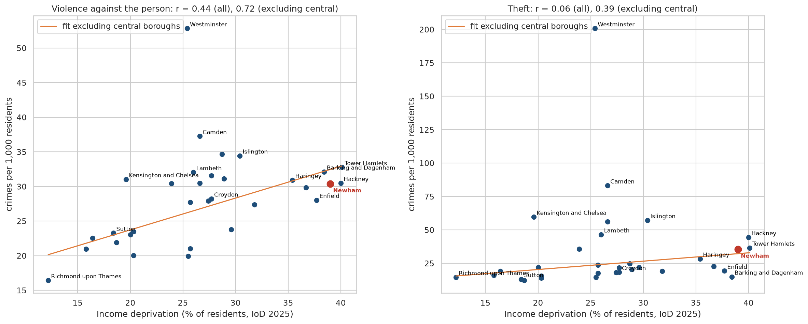
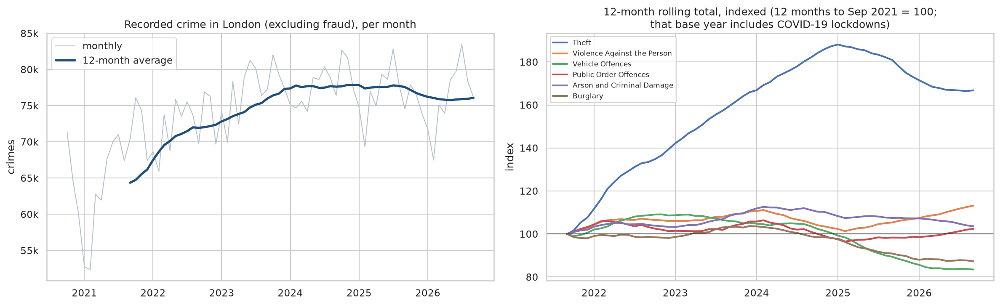
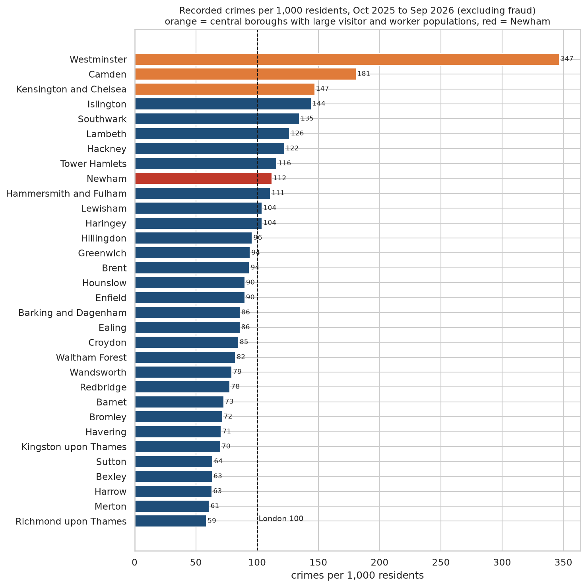
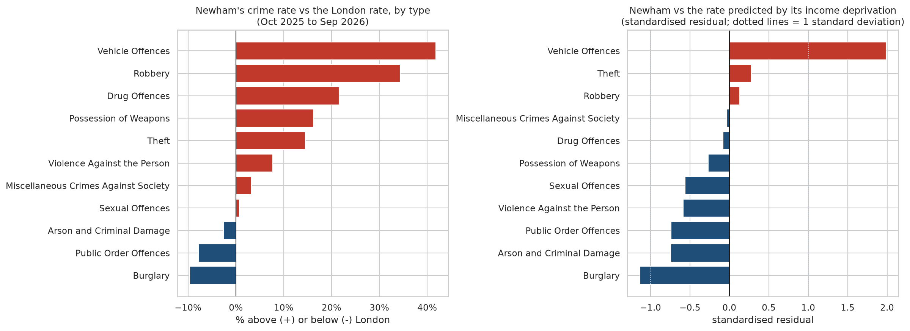
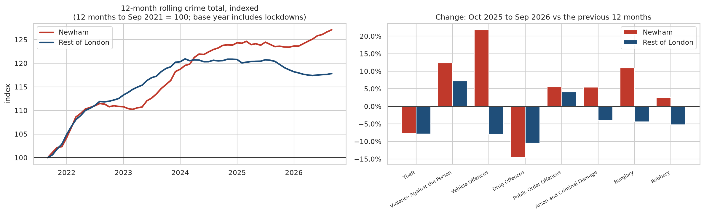

# Crime and Deprivation in London: A Borough-Level Analysis Featuring Newham

**Joining Metropolitan Police crime records, the 2025 Indices of Deprivation and ONS population estimates to answer policy questions about where crime is concentrated, how it links to deprivation, and where Newham stands.**

*Anthony Adusei-Poku · MSc Data Science, University of East London (2025)*

   

<p align="center"></p>

## TL;DR

* London recorded **912,988 crimes (excluding fraud) between October 2025 and September 2026, 100.2 per 1,000 residents**, down **1.9%** on the previous year.
* Resident-based rates make central boroughs look extreme (**Westminster: 346.5 per 1,000** vs **Richmond upon Thames: 58.6**) because of large visitor and worker populations. Leaving out Westminster, Camden and Kensington and Chelsea, **income deprivation explains a large share of the differences between boroughs**: correlation r = **0.76 for drug offences, 0.72 for violence, 0.60 for robbery**, and 0.39 for theft.
* **Newham** is London's 2nd most deprived borough on the 2025 Index of Multiple Deprivation (29th of 296 districts in England), with **39.0% of residents income-deprived** against a London borough median of 26.6%.
* Newham's overall crime rate (**112.2 per 1,000**, 9th highest of 32) is **11.9% above London's** but **almost exactly what its deprivation predicts** (110.9). Violence and burglary are *below* the level predicted.
* The outlier is **vehicle crime**: Newham has the **2nd highest rate in London (13.1 per 1,000, 41.8% above London)**, about **2 standard deviations above** what deprivation predicts, and it **rose 21.8% in the last year while it fell 7.9% in the rest of London**.

## 1. Policy questions

1. How has recorded crime in London changed over the last six years?
2. Which boroughs have the highest crime rates once population is taken into account?
3. How closely does crime track deprivation, and which crimes are most linked to it?
4. How does Newham compare, and is its crime higher or lower than its deprivation would predict?

## 2. Data

| Dataset | Coverage | Source | Licence |
|---|---|---|---|
| MPS recorded crime by borough, category and month | Oct 2020 to Sep 2026, 32 boroughs | [London Datastore](https://data.london.gov.uk/dataset/mps-recorded-crime-geographic-breakdown-exy3m) (files published 25 Sep 2026) | Open Government Licence v2 |
| English Indices of Deprivation 2025, File 10 (local authority summaries, v2) | 296 districts in England | [MHCLG / GOV.UK](https://www.gov.uk/government/statistics/english-indices-of-deprivation-2025) | Open Government Licence v3 |
| Mid-2025 population estimates by local authority | all districts | [ONS via Nomis](https://www.nomisweb.co.uk/) | Open Government Licence v3 |

All raw files are small (under 250 kB each) and are committed in `data/raw/`; `src/download_data.py` re-downloads them.

## 3. Method

* **Cleaning:** stacked the historical and recent MPS files (same Home Office categories, no overlapping months; no duplicates, negatives or missing values). Removed non-borough rows ("Aviation Policing", "Unknown") and **fraud**, which is mostly reported nationally to Action Fraud and does not reflect local crime (0.1% of records removed in total). The City of London has its own police force and is not included.
* **Rates:** crimes per 1,000 residents over the latest 12 months (Oct 2025 to Sep 2026), using mid-2025 population.
* **Deprivation measure:** the IoD 2025 **Income domain** score (share of residents who are income-deprived). The overall IMD contains a crime domain, so using it to "explain" crime would be partly circular.
* **Statistics:** Pearson and Spearman correlations across boroughs, with and without the three central boroughs; an OLS regression of each crime rate on income deprivation (29 non-central boroughs) to get Newham's expected rate and standardised residual; year-on-year and indexed trends.

## 4. Findings

### 4.1 London trend: down slightly in the last year, after a post-lockdown rebound

| 12 months to September | Recorded crimes (excluding fraud) |
|---|---:|
| 2021 (includes lockdowns) | 772,266 |
| 2022 | 863,429 |
| 2023 | 911,846 |
| 2024 | 931,483 |
| 2025 | 930,878 |
| **2026** | **912,988 (-1.9% on 2025)** |

Crime rose 18.2% from the lockdown-affected 2020/21 base, peaked in the year to September 2024 and has since edged
down. Over the six years, burglary (-12.7%) and vehicle offences (-16.5%) fell while theft (+66.8%) and robbery
(+37.9%) rose, though much of that rise is a return from lockdown lows.

<p align="center"></p>

### 4.2 Borough rates: central London distorts resident-based league tables

Westminster records **346.5 crimes per 1,000 residents**, 3.5 times the London rate, because millions of visitors and
workers are counted in the crimes but not the population. Richmond upon Thames is lowest at **58.6**. Newham is 9th
highest at 112.2.

<p align="center"></p>

### 4.3 Crime and deprivation

| Crime type | r (all 32 boroughs) | r (excluding 3 central boroughs) | Spearman rho (all) |
|---|---:|---:|---:|
| Drug offences | 0.35 | **0.76** | 0.54 |
| Violence against the person | 0.44 | **0.72** | 0.55 |
| Robbery | 0.34 | **0.60** | 0.62 |
| Possession of weapons | 0.40 | **0.59** | 0.60 |
| **All crime (excluding fraud)** | 0.17 (not significant) | **0.59** | 0.47 |
| Burglary | 0.26 | 0.58 | 0.42 |
| Theft | 0.06 | 0.39 | 0.37 |

With the central boroughs included, the link between all crime and deprivation disappears (r = 0.17, p = 0.36)
because theft in the West End dominates. Rank-based (Spearman) correlations and the analysis without central
boroughs show a clear pattern: **violence, drugs, robbery and weapons offences are concentrated in more deprived
boroughs**, while theft follows footfall rather than deprivation. Full table: [`results/deprivation_correlations.csv`](results/deprivation_correlations.csv).

### 4.4 Newham in focus

| | Newham |
|---|---|
| Population (mid-2025) | 376,542 |
| IMD 2025 rank (1 = most deprived) | 29th of 296 in England, 2nd of 32 London boroughs |
| Income-deprived residents | 39.0% (3rd in London, 4th in England; London borough median 26.6%) |
| Crimes, Oct 2025 to Sep 2026 | 42,241, **112.2 per 1,000** (London 100.2), 9th highest of 32 |
| Predicted from deprivation | 110.9 per 1,000: Newham is in line with expectation |

| Crime type | Newham rate per 1,000 | vs London | Rank of 32 | vs prediction (SD) | Change on last year (Newham / rest of London) |
|---|---:|---:|---:|---:|---:|
| Theft | 35.6 | +14.5% | 10 | +0.3 | -7.7% / -7.8% |
| Violence against the person | 30.4 | +7.7% | 15 | -0.6 | +12.4% / +7.2% |
| **Vehicle offences** | **13.1** | **+41.8%** | **2** | **+2.0** | **+21.8% / -7.9%** |
| Drug offences | 6.5 | +21.6% | 8 | -0.1 | -14.6% / -10.5% |
| Robbery | 4.7 | +34.4% | 7 | +0.1 | +2.5% / -5.2% |
| Burglary | 4.7 | -9.6% | 18 | -1.1 | +11.0% / -4.4% |

<p align="center"></p>

* **Vehicle crime is Newham's distinctive problem.** Theft from vehicles is 49% above the London rate and theft or
  unauthorised taking of vehicles 41% above. It is the only crime type well above what deprivation predicts, and it is
  rising against the London trend.
* **Robbery and theft from the person are high** (theft from the person 33% above London), but robbery is in line with
  what Newham's deprivation predicts. Stratford's transport hub and shopping centre are a likely contributor to
  theft from the person, though this data cannot show it.
* **Violence is lower than Newham's deprivation would predict**, but it rose 12.4% in the last year, faster than the
  rest of London (+7.2%).
* **Overall, Newham's crime rose 2.9% in the last year while the rest of London fell 2.1%.** Since the year to
  September 2021 Newham's crime is up 27.1% against 17.8% for the rest of London.

<p align="center"></p>

## 5. Policy implications

1. **Target vehicle crime in Newham.** It is the clearest Newham-specific anomaly: second highest in London, about two standard deviations above expectation and rising while London falls. Hotspot analysis at ward level, car park and street design, and joint work with neighbouring boroughs are the obvious next steps.
2. **Watch the upturn in violence and burglary**, both rising faster in Newham than in the rest of London over the last year.
3. **Tackle the deprivation-linked crimes upstream.** Violence, drugs, robbery and weapons offences track income deprivation closely across London, which supports prevention funding (youth services, employment support) weighted towards the most deprived boroughs.
4. **Do not rank boroughs on resident-based rates alone.** Central boroughs need footfall-based denominators; otherwise resources get misallocated.

## 6. Limitations

* **Recorded crime is not all crime.** It depends on reporting and police activity; drug and weapons offences in particular reflect proactive policing (for example stop and search) as much as underlying prevalence.
* **Ecological fallacy:** borough-level correlations describe areas, not individuals, and do not prove that deprivation causes crime. With 32 boroughs, estimates are noisy.
* **Denominators:** resident population ignores commuters, shoppers and tourists.
* **Data systems:** the MPS moved to a new recording system (CONNECT) in February 2024, which the London Datastore warns can affect comparisons across that date.
* **Base year:** the first year of data includes COVID-19 lockdowns, so six-year changes are inflated.
* **Timing:** IoD 2025 is built from the latest data available when it was produced (it uses mid-2022 population weights), so it lags the crime data; population is a mid-2025 estimate.

## 7. How to run

```bash
git clone <this-repo> && cd london-public-sector-analysis
python -m venv .venv && source .venv/bin/activate
pip install -r requirements.txt
python src/download_data.py            # optional: raw data is already in data/raw/
jupyter nbconvert --to notebook --execute --inplace notebooks/london_crime_deprivation.ipynb   # ~10 seconds
```

## Repository structure
```
london-public-sector-analysis/
├── notebooks/
│   ├── london_crime_deprivation.ipynb   # full analysis, executed with outputs
│   ├── london_crime_deprivation.html    # static HTML export
│   └── london_crime_deprivation.py      # same code as a plain Python script
├── src/download_data.py                 # downloads all three open datasets
├── data/raw/                            # raw crime, deprivation and population files (OGL)
├── figures/                             # charts (PNG)
├── results/                             # borough table, correlations, Newham profile, offence detail
└── requirements.txt
```

## Skills shown
Public-sector open data · joining datasets on ONS geography codes · data cleaning and validation · rate
standardisation · correlation and regression · residual analysis to benchmark one area against expectations ·
trend analysis · clear charts · policy-style findings with honest limitations.
